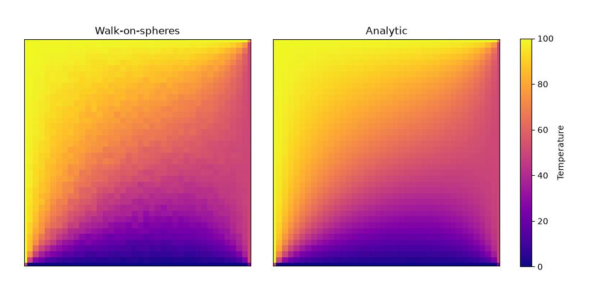

# Walk-on-spheres solution to Laplace's equation

The walk-on-spheres (WoS) method is a Monte Carlo technique that can be used to numerically solve boundary value problems for certain PDEs.

The method works by simulating paths of Brownian motion by sampling only exit points of paths from a region, rather than entire paths.
It does this by creating the largest sphere that remains within the domain about an initial sample point, and then selecting a random point on that sphere as the next sample point.
The use of random selection is a result of having no preferential treatment to any particular direction.

When a sampled point falls within a small distance $\epsilon$ of the boundary (within the $\epsilon$-shell), the path is to be considered terminated at that point on the boundary, and the value of the boundary condition at that point is assigned to the path.
By building up statistics for each initial starting point, an estimate of the analytic solution at that point can be made.

## Steady state heat equation on a plane

The method is implemented and tested on square plane with Dirichlet boundary conditions representing temperature.
The steady state solution to the heat equation is given by Laplace's equation, which allows an analytic solution to be generated for comparison with WoS.

WoS is used to sample a 40 $\times$ 40 grid of points within a unit square, with a $\epsilon$ = 0.01.
1000 Brownian paths are generated for each sample point.
The WoS approach is compared against the analytic solution, and the two approaches show good agreement.

## Potential optimisations
- Change $\epsilon$-shell
- Parallelisation (OpenMP)
- [Boundary value caching](https://arxiv.org/abs/2302.11825)
